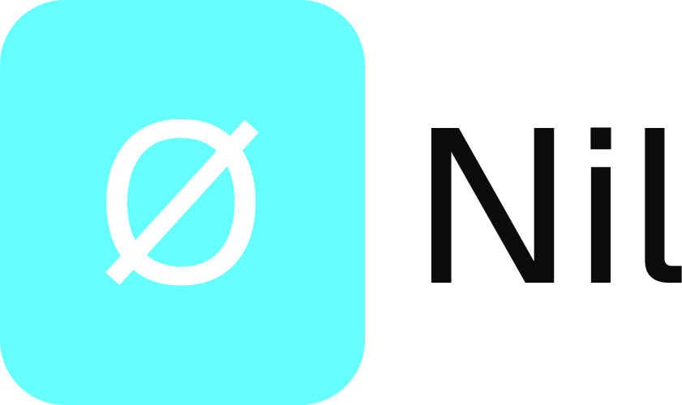
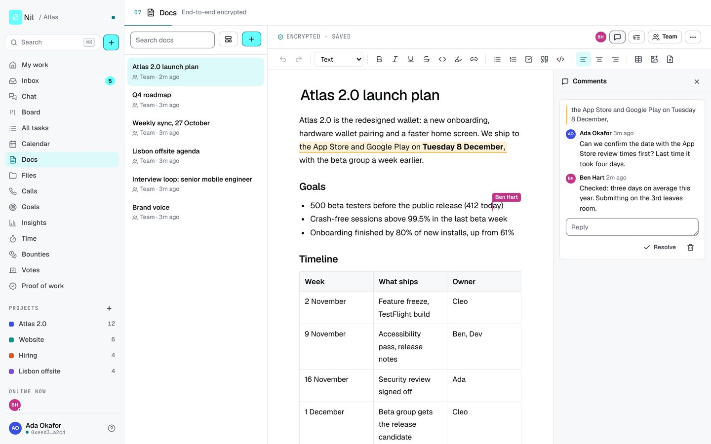
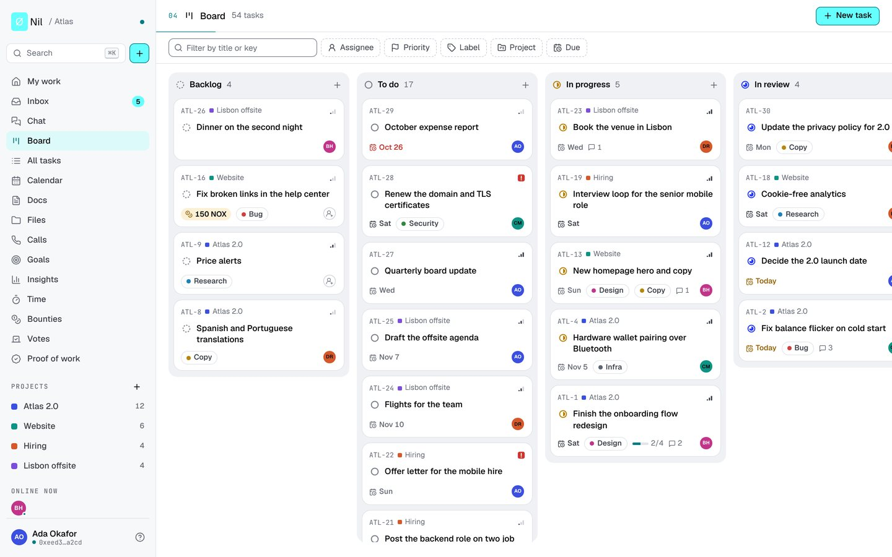
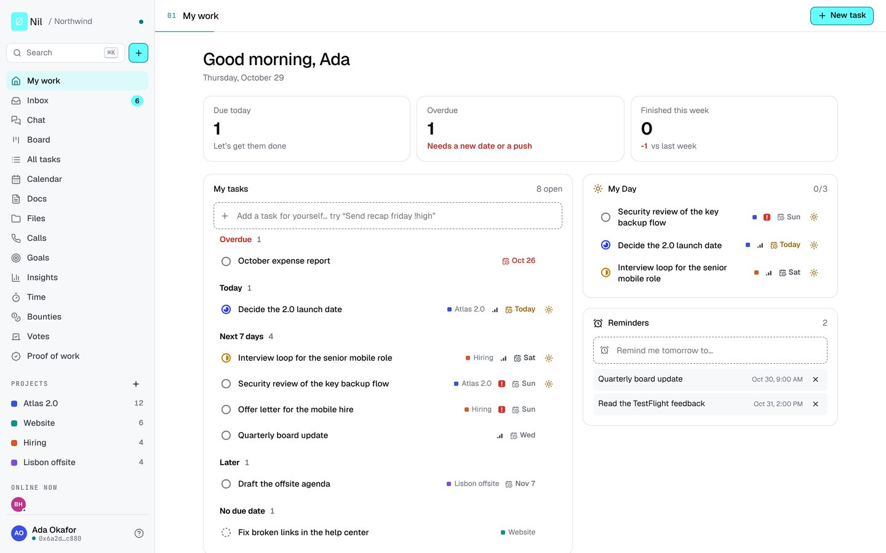
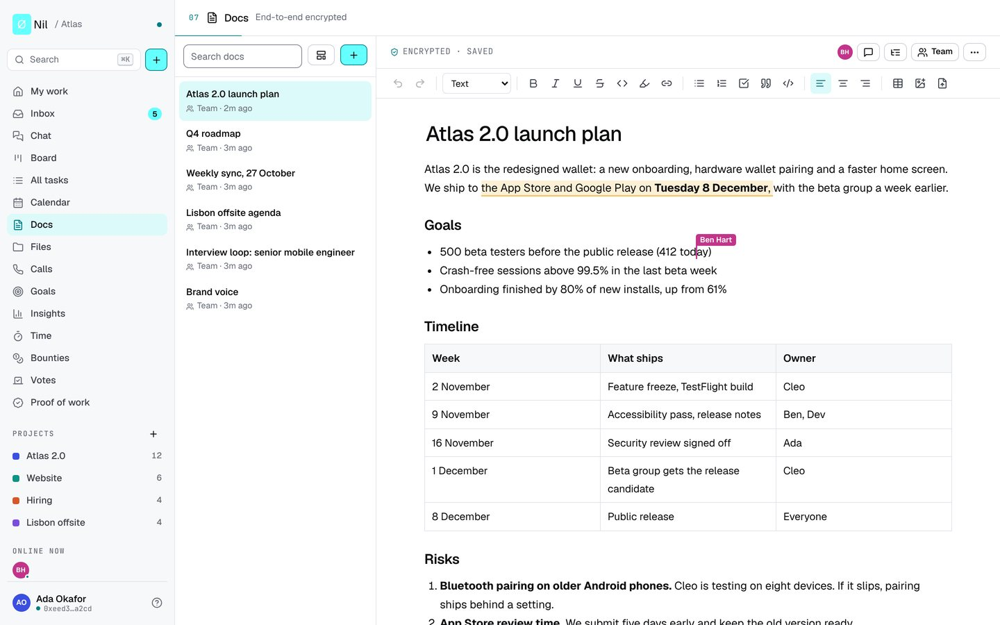
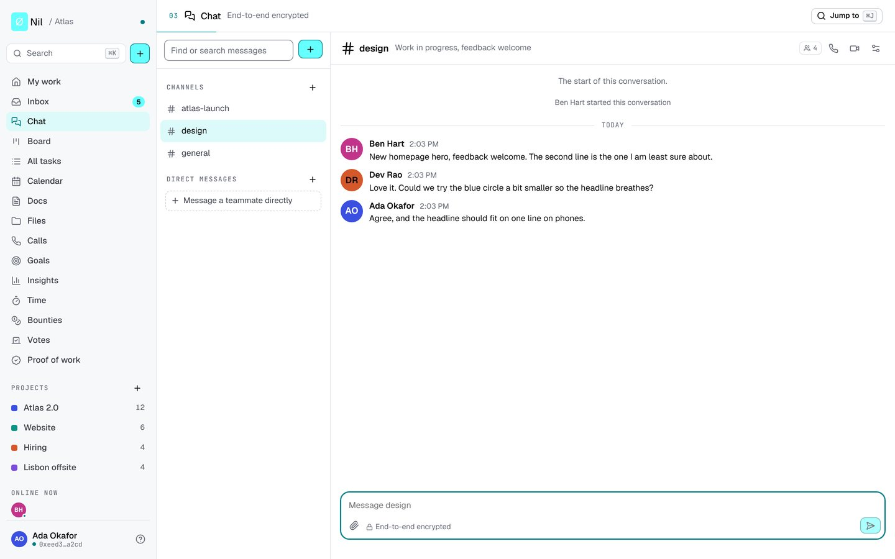
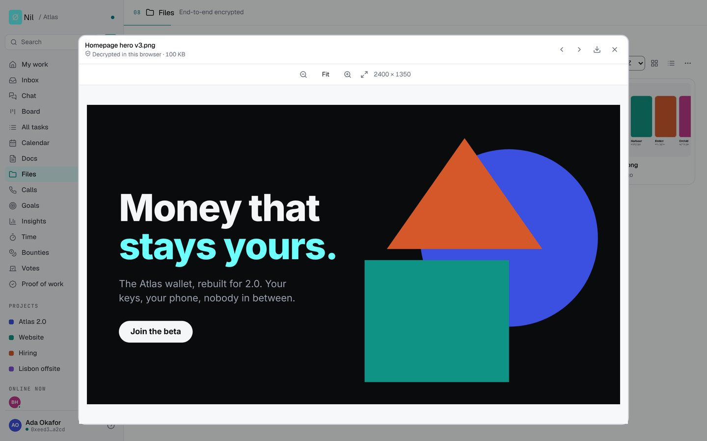
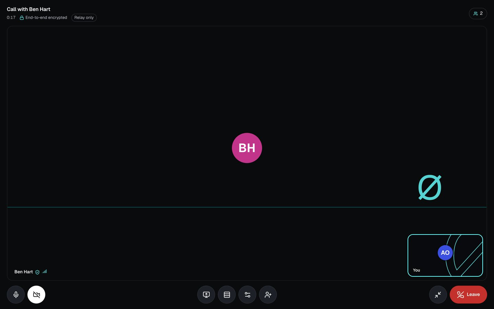

<p align="center">
  <picture>
    <source media="(prefers-color-scheme: dark)" srcset="docs/media/nil-logo-dark.svg">
    
  </picture>
</p>

<p align="center">
  The private workspace for teams who sign in with a wallet.<br>
  Tasks, docs, chat, files and calls. Docs, chat, files and private tasks are encrypted in your browser before they reach the server.
</p>

<p align="center">
  <a href="https://nil.nonos.app"><strong>Try it at nil.nonos.app</strong></a> ·
  <a href="docs/README.md">Documentation</a> ·
  <a href="#run-it-yourself">Run it yourself</a> ·
  <a href="docs/privacy-model.md">Privacy model</a>
</p>

<p align="center">
  <a href="https://github.com/NON-OS/NIL/actions/workflows/ci.yml"></a>
  
  
  
</p>



## What's inside

| | |
|---|---|
|  |  |
| Tasks in board, list and calendar views, with goals, insights, time tracking, reminders and a quick add that understands "Call Ana friday !high". | My work puts what's due, what's late, your own My Day list and your reminders on one page. |
|  |  |
| Docs you edit together live, with cursors and comments. Each change is encrypted and padded before it leaves your browser. | Chat in channels, direct messages and threads. Each conversation has its own key, and a new one when someone leaves. |
|  |  |
| Files in shared folders, with previews of pictures, video, PDF and Office files. They're sealed in pieces and open only on your screen. | Calls with sound, video and screen sharing go browser to browser through your relay, checked against the keys your teammates confirmed. Self-hosted servers have them now; hosted Nil will follow. |

## What the server can read

Nil splits a workspace into what the server never sees and what it keeps in plain form. The [privacy model](docs/privacy-model.md) has the full list.

| Encrypted in your browser | Stored in plain form |
|---|---|
| Docs, titles included | Team tasks, their comments and history |
| Chat messages, files, channel names and topics | Goals, projects and labels |
| Files in shared folders, with their names and thumbnails | Time entries and reminders |
| The title, notes, checklist, comments and files of private tasks | People, their names, roles and wallet addresses |
| Ballots of encrypted weighted votes | Bounty amounts and payment records |

Doc changes and chat messages are padded to fixed sizes before they're encrypted, so the size of what reaches the server says little about what you wrote.

## Made for crypto teams

You sign in with an Ethereum wallet: no email, no password, no phone number. Passkeys can unlock your keys too.

- Bounties on tasks, paid in NOX or USDC from an admin's wallet straight to the contributor's. Nil never holds the money; it reads the chain to confirm the payment and signs a receipt.
- A public bounty board where people outside the team can apply with their wallet.
- Votes that are signed, anonymous (Semaphore) or weighted by holdings with encrypted ballots that two of three trustees open together.
- Private payouts to stealth addresses, so a payment doesn't link to the contributor's main wallet.
- A token-holder door that lets anyone holding enough NOX join without an invite.
- AI agents and assistants over MCP, with personal access tokens.

## Checked, not just claimed

- Nil's web app builds to the same bytes on any machine and every release publishes their hash, so anyone can confirm a server sends exactly a release's code. See [Check what a server sends](docs/verify-a-server.md).
- Ballot counting, the encrypted vote tally, stealth payouts, rollback warnings, invoices and who may change an encrypted chat's key are modelled and proven in [`formal/`](formal), and tests check the JavaScript against the models. [Formal verification](docs/formal-verification.md) says what is proven and what isn't.
- Over 1,200 tests run in CI, including attack tests on sessions, uploads, chat, calls and payments.

No part of Nil's own code has had an independent security audit yet, and encrypted weighted votes are in beta.

## Pricing

On hosted Nil, your first workspace starts with a free trial. After that, Nil Pro costs $4 per 30 days in USDC, or $2 when you pay in NOX, plus $1 for each person above five (half in NOX). Nothing renews by itself and no card or email is asked for. [NOX, voting power and Nil Pro](docs/nox-and-nil-pro.md) has the details.

## Run it yourself

You need a browser with an Ethereum wallet extension, or a wallet's in-app browser, to sign in.

With Docker (Compose v2.24 or newer):

```bash
git clone https://github.com/NON-OS/NIL.git nil
cd nil
cp .env.example .env        # APP_URL starts as http://localhost:3000 for trying it here
docker compose up -d --build
```

Open `http://localhost:3000`, connect your wallet and create the workspace with the one-time setup token from the log (`docker compose logs nonos | grep 'setup token'`). You become the owner.

With plain Node (22.13 or newer):

```bash
npm ci
npm run build
cp .env.example .env
node --env-file=.env --disable-warning=ExperimentalWarning server/index.js
```

For development, run `npm install` and `APP_URL=http://localhost:5173 npm run dev`, then open `http://localhost:5173`. `npm run demo` fills a server with a sample team and takes screenshots of every screen.

For a public server with HTTPS, follow [Production deployment](docs/deploy.md). Every setting is explained in [.env.example](.env.example). Running Nil for your own team is free; see the [licence](#licence).

## Documentation

The full documentation is in [docs/](docs/README.md). The same pages are in the app under **Help**.

| Area | Pages |
|---|---|
| Start here | [Getting started](docs/getting-started.md), [Signing in](docs/signing-in.md), [People and roles](docs/people-and-roles.md) |
| Everyday work | [Tasks](docs/tasks.md), [Views and finding things](docs/views.md), [Time and reminders](docs/time-and-reminders.md), [Goals, insights and decks](docs/goals-and-insights.md), [Calls](docs/calls.md), [Keyboard shortcuts](docs/keyboard-shortcuts.md) |
| Privacy and encryption | [Private tasks](docs/private-tasks.md), [Encrypted docs](docs/encrypted-docs.md), [Chat](docs/chat.md), [Files](docs/files.md), [Privacy model](docs/privacy-model.md), [Encryption and trust](docs/encryption.md), [Zero-state](docs/zero-state.md), [Check what a server sends](docs/verify-a-server.md) |
| Money and decisions | [Bounties and payouts](docs/bounties-and-payouts.md), [Private payouts](docs/private-payouts.md), [Public bounty board](docs/public-bounty-board.md), [Votes](docs/votes.md), [NOX, voting power and Nil Pro](docs/nox-and-nil-pro.md), [Proof of work](docs/proof-of-work.md) |
| Sharing and AI | [Sharing and guests](docs/sharing-and-guests.md), [AI assistants](docs/ai-assistants.md), [AI agents](docs/ai-agents.md) |
| Your data and your server | [Backups and moving](docs/backups-and-moving.md), [Self-hosting](docs/self-hosting.md), [Hosted Nil](docs/hosted.md), [Production deployment](docs/deploy.md), [Tor onion service](docs/tor.md), [Development](docs/development.md) |
| Reference | [Proof file format](docs/proof-format.md), [Formal verification](docs/formal-verification.md), [FAQ](docs/faq.md), [Glossary](docs/glossary.md) |

To report a vulnerability, see [SECURITY.md](SECURITY.md). To contribute, see [CONTRIBUTING.md](CONTRIBUTING.md). See [CHANGELOG.md](CHANGELOG.md) for what changed in each version.

## Licence

Nil's source is available under the Business Source License 1.1. You may read, audit, build and test it, and run it in production for your own organization, including its employees, contractors and members, free of charge. Offering it to other people or organizations as a hosted or managed service, or selling access to it, needs a license from NØNOS: write to ops@nonos.app. Four years after each version is published, that version becomes available under the GNU Affero General Public License v3 or later. See [LICENSE](LICENSE). Third-party components keep their own licences; see [NOTICE.md](NOTICE.md).

The Nil and NØNOS names and logos are not covered by the licence. See [TRADEMARKS.md](TRADEMARKS.md).
